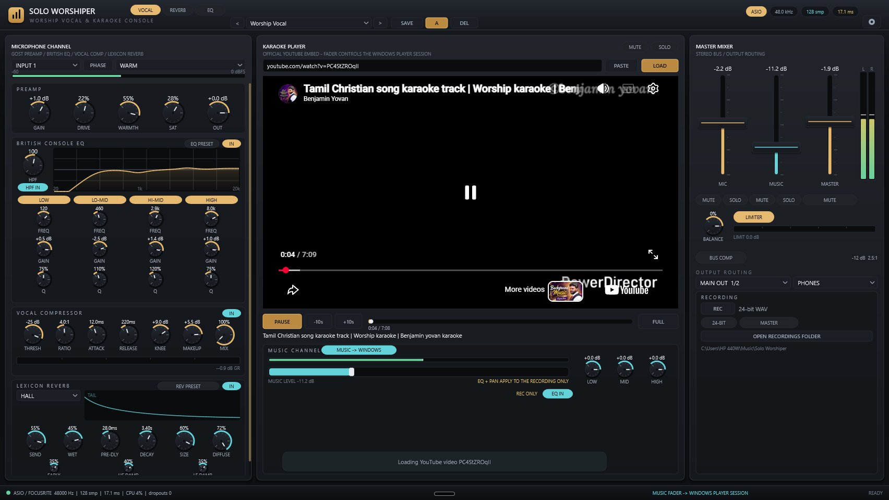

# SOLO WORSHIPER

A native Windows karaoke and live vocal mixing console. Microphone in, processed
vocal out, karaoke playback mixed in from a YouTube embed — through a real
low-latency audio engine, not a simulation.



## What it is

* **Native C++20 / Win32 / Direct2D** application. No Electron, no browser UI, no
  framework runtime. One 3 MB executable plus the Windows WebView2 runtime that
  ships with Windows 11 and modern Windows 10.
* **Signal chain**: GoST-style preamp (gain / drive / warmth / saturation / output,
  phase, three voicing modes) → 12 dB/oct high pass → four-band British console EQ
  (shelf / peak / shelf with per-band enable and Q) → vocal compressor with knee,
  makeup and parallel mix → Lexicon-style reverb (8 algorithms, pre-delay, decay,
  size, diffusion, damping, early reflections) → master bus with balance, bus
  compressor and brickwall limiter.
* **Karaoke**: official YouTube embed in an embedded WebView2 control, served from a
  local `https://lvs.local` origin so the player accepts the embed. Nothing is
  downloaded, ripped or extracted. The `MUSIC` fader and `MUTE` drive the player's
  own Windows audio session, so the level you hear is the level the fader shows;
  the loopback copy of that audio feeds the `MUSIC CHANNEL` meter and the recording
  tap. `docs/ROUTING.md` explains exactly why this is split that way.
* **Recording**: 24-bit or 32-bit float WAV of either the vocal bus or the full
  master mix, straight to `Documents\Music\Solo Worshiper`.
* **Presets**: 8 vocal chains, 7 reverb settings and 5 EQ shapes, all recallable
  from the category bar. `EQ PRESET` and `REV PRESET` open the full list for that
  section and apply it without disturbing the rest of the chain. User presets are
  JSON files under `%APPDATA%\SoloWorshiper`, with A/B compare and custom names.

## Requirements

| Item | Requirement |
| --- | --- |
| OS | Windows 10 1809+ or Windows 11, x64 |
| CPU | Any AVX2-capable dual core (DSP is float32, ~3 % of one core at 128 frames) |
| Audio | Any Windows audio device. Focusrite Scarlett 2i2 Gen 2 is the reference unit |
| Runtime | WebView2 Runtime (preinstalled on Windows 11; the installer bootstraps it) |
| Display | 1280×720 minimum, 1920×1080 recommended, touch or mouse |

## Quick start

1. Install with `SoloWorshiperSetup.exe`, or run `build\SoloWorshiper.exe`.
2. Connect the interface. The status bar should read
   `ASIO / FOCUSRITE 48000 Hz | 128 smp | 17.1 ms` and the dot turns green.
3. Speak or sing. The `MICROPHONE CHANNEL` meter moves; use **GAIN** for level.
   `GAIN` is digital trim from −12 to +36 dB: set the Scarlett's own gain knob so
   the meter peaks around −12 dBFS, then add trim only if the voice is still quiet.
   `CLIP` lights beside the meter when the input reaches full scale.
4. Paste a YouTube link into the karaoke field (the **PASTE** button, `Ctrl+V`, or just
   type it) and press **LOAD**.
5. Press play. Set `MUSIC` on the mixer to taste.

> **Use headphones for monitoring.** On a 2-in/2-out interface the karaoke audio
> leaves through the same outputs the microphone hears through the room, so
> speakers plus an open microphone is a feedback loop by construction.

## Installer

`dist\SoloWorshiperSetup-1.0.0.exe` is the Windows setup program, compiled from
`installer\lvs.iss` with Inno Setup 6 (`tools\installer.bat`). It installs to
`%ProgramFiles%\Solo Worshiper`, adds Start Menu and optional desktop shortcuts,
and runs the WebView2 Evergreen bootstrapper only when the runtime is missing.
User settings, presets and recordings stay outside the install folder, so
uninstalling leaves your work alone.

The setup program was compiled, executed end to end (UAC accepted), and confirmed
to install to `%ProgramFiles%\Solo Worshiper`, launch the console, and uninstall
cleanly. Uninstall removed the Start Menu entry and the installed files; it left
`%APPDATA%\SoloWorshiper` (settings, presets) and any recordings under
`Documents\Music\Solo Worshiper` untouched.

## Android (phones and tablets)

`android\` is a separate application for Android 8.0 and newer
(`dist\SoloWorshiper-Android-1.0.0.apk`, package `com.soloworshiper.app`). It carries
the same ordered queue as the console: paste a YouTube video or playlist link and
the songs appear with the current one and `UP NEXT`, with previous, next and
tap-to-jump; local audio and video files added with `ADD FILES` join that same
queue and play through the app's own Media3 player. `MIC` runs a monitoring chain —
80 Hz high pass, three-band EQ, compressor, reverb send, soft limiter — at 48 kHz
on a low-latency duplex path with a live input meter.

What it deliberately does not do: Android gives no application access to another
app's or the system mixer's audio, so the karaoke track is heard from the phone and
is **not** mixed into the vocal path, and this build does not record. That is a
platform limit, not a missing feature that the UI hides.

Build and install steps are in [`android/README.md`](android/README.md).

## Latency, honestly

Measured on the reference machine (Focusrite Scarlett 2i2 Gen 2, Windows 11,
48 kHz, 128 frames):

| Path | Reported latency | How it was obtained |
| --- | --- | --- |
| ASIO driver | in 6.23 ms / out 8.23 ms | `ASIOGetLatencies()` from the driver |
| ASIO buffer | 2.67 ms (128 / 48000) | arithmetic |
| Round trip, estimated | ~17.1 ms | driver latency + one buffer each way, shown in the title bar |
| WASAPI exclusive | 80 ms (3528 frames) | buffer size the driver actually grants |
| WASAPI shared | 22 ms (970 frames) | buffer size the driver actually grants |

The 17.1 ms figure is an **estimate** built from the driver's own numbers plus one
buffer period. It is not a measured acoustic round trip — no loopback cable or
microphone measurement was used. Measuring the real round trip requires a physical
loopback (output → input) and is described in `docs/TESTING.md`.

ASIO is the default because the Focusrite WDM driver refuses small exclusive
buffers (80 ms) and its shared mode floors at 22 ms. WASAPI paths remain available
in Settings for machines without an ASIO driver.

## Layout of this repository

```
src/
  main.cpp              Win32 entry point (DPI awareness, COM apartment)
  app/App.h/.cpp        window, message loop, timers, presets, recording, settings
  app/Console.cpp       console layout, drawing, hit regions, popups
  ui/Ui.h/.cpp          Direct2D surface, knobs, faders, meters, EQ curve
  audio/Engine.h/.cpp   device handling, mixing, measurement, reconnection
  audio/Asio.h/.cpp     ASIO 2.3 host implementation (self-declared interface)
  audio/Wasapi.h/.cpp   WASAPI render/capture/loopback clients
  audio/Recorder.cpp    WAV writer (24-bit PCM / 32-bit float)
  audio/SessionVolume   drives the embedded player's Windows audio session
  dsp/Effects.h         biquads, preamp, EQ, compressor, reverb, limiter
  core/Params.h/.cpp    the parameter table every control maps to
  core/Presets.cpp      factory presets, user presets, JSON persistence
  core/Settings.cpp     device + UI settings in %APPDATA%
    web/PlaylistFetch.cpp playlist listing (public page, no API key)
  web/YouTubeHost.cpp   WebView2 host, URL parsing, oEmbed title, title polling
android/                phone and tablet build (Java, Media3, WebView embed)
dist/                   the Windows setup program and the Android APK
tools/
  build.bat             configure + build (MSVC 14.51, CMake, Ninja)
  probe.cpp             console self-test: devices, ASIO, dropout counters
  latencytest.cpp       what buffer sizes each driver actually grants
docs/                   architecture, build, routing, testing, troubleshooting
installer/lvs.iss       Inno Setup script
```

## Documentation

* [`docs/ARCHITECTURE.md`](docs/ARCHITECTURE.md) — threading model, buffers, DSP order
* [`docs/BUILD.md`](docs/BUILD.md) — toolchain, dependencies, build and packaging
* [`docs/ROUTING.md`](docs/ROUTING.md) — how karaoke audio is captured and mixed
* [`docs/TESTING.md`](docs/TESTING.md) — test procedures, including latency measurement
* [`docs/TROUBLESHOOTING.md`](docs/TROUBLESHOOTING.md) — the failures you will actually hit

## Known limitations

* Two hardware outputs only, matching the reference interface. The `PHONES` selector
  is shown but collapses to the same 1/2 pair when the device reports two channels —
  the application does not pretend otherwise.
* A crash or power loss during recording leaves a WAV whose header was not
  finalised; the audio data is intact and repairable with any WAV header tool.
* Because YouTube audio is heard straight from Windows, the music strip's `EQ` and
  `PAN` act on the captured copy that is metered and recorded, not on what the
  speakers play — the `MUSIC` fader is the live control. The strip says so: the
  chip reads `MUSIC -> WINDOWS` and the caption `EQ + PAN APPLY TO THE RECORDING
  ONLY`, with `REC ONLY` beside the strip's `EQ IN`. Clicking the chip moves the
  song onto the console bus (`MUSIC -> BUS`, everything live) when karaoke plays
  on a different device than the console output; on one shared device it refuses
  and explains why, because a bus copy there would double the song. Local files
  decoded inside the console will not have this split; everything will run
  through the bus.
* The karaoke player needs network access; the console is fully functional offline.
* YouTube playback is subject to the embed's own restrictions (age-gated or
  region-blocked videos will not play; the player reports the error itself).

## Licence and third-party components

Application code is yours. It links against the Microsoft WebView2 loader
(Microsoft license, redistributable) and uses the Windows SDK only. ASIO is
implemented from the published 2.3 interface declaration — no Steinberg SDK files
are redistributed, and the ASIO driver is loaded from the copy the interface's own
driver installation provides.
